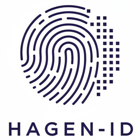
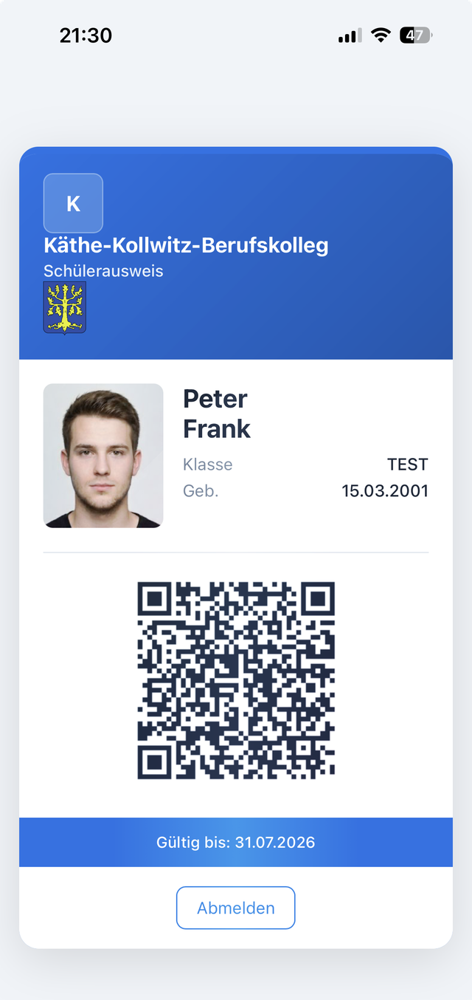
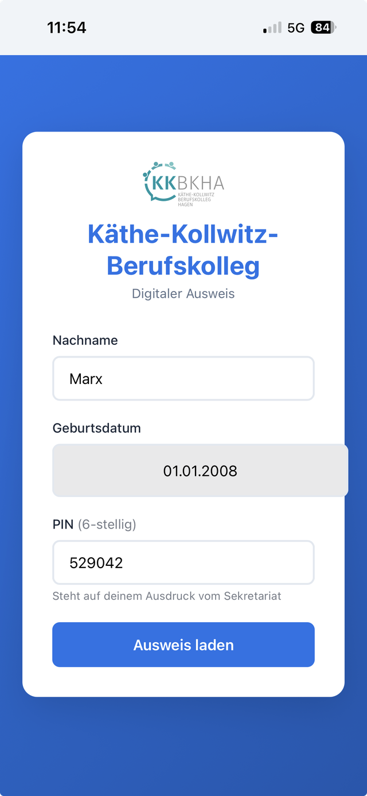
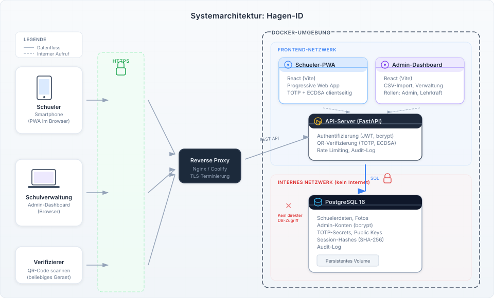

<p align="center"></p>

# Hagen-ID — Digitaler Schülerausweis

> Datenschutzkonform, fälschungssicher und offline-fähig — als Progressive Web App direkt im Browser, ohne App-Store.

[](https://github.com/beitist/schuelerausweis/actions/workflows/ci.yml)

<p align="center">
  
  &nbsp;&nbsp;
  
</p>

Hagen-ID ersetzt den klassischen Papier- oder Plastikausweis durch eine digital
verifizierbare Lösung: Schülerinnen und Schüler melden sich mit Nachname,
Geburtsdatum und einer 6-stelligen PIN an und erhalten ihren Ausweis mit einem
**alle 30 Sekunden wechselnden, kryptografisch signierten QR-Code**. Wer den
Ausweis prüfen will, scannt den Code mit einem beliebigen Smartphone — ohne
spezielle App.

Entwickelt für den Schulkontext in NRW (DSGVO, VO-DV I/II), pilotiert an einem
Berufskolleg in Hagen.

---

## Features

- **Keine App-Installation** — PWA im Browser, optional zum Homescreen hinzufügbar; funktioniert nach dem ersten Login auch offline
- **Fälschungssicherer QR-Code** — TOTP (RFC 6238) plus gerätegebundene digitale Signatur (ECDSA P-256); ein Screenshot ist wertlos
- **Ein-Geräte-Prinzip („Highlander")** — der Ausweis ist immer nur auf genau einem Gerät gültig; ein neuer Login entwertet das alte
- **Dienstausweise für Lehrkräfte** — inklusive Foto-Self-Upload direkt aus der App
- **Admin-Dashboard** — CSV-Import aus der Schulverwaltung (z. B. SchILD-NRW) mit Diff-Vorschau, PIN-Kartendruck (einzeln oder Sammeldruck), Klassen- und Benutzerverwaltung
- **Sync-API** — REST-Schnittstelle für externe Tools zum automatisierten Abgleich des Schülerbestands (API-Key pro Schule, optional IP-Allowlist); als fertiges Gegenstück fürs Sekretariat gibt es [SchildSpider](https://github.com/beitist/schild-spider)
- **Schul-/Dienstbescheinigung als PDF** — mit dauerhaftem Verifizierungs-QR, der beim Scannen den Live-Einschreibestatus zeigt
- **Mandantenfähig** — mehrere Schulen pro Installation, Trennung zusätzlich per PostgreSQL Row-Level-Security auf Datenbankebene erzwungen

## So funktioniert die Verifizierung

<p align="center">
  
</p>

Der QR-Code enthält Schüler-ID, TOTP-Code, Session-Kennung, Zeitstempel und
eine Signatur über all diese Daten. Der Server prüft beim Scan: TOTP gültig?
Zeitstempel frisch? Session aktiv? Signatur passt zum registrierten
Geräteschlüssel? Erst wenn alle Prüfungen bestehen, gilt der Ausweis als
verifiziert (fail-closed).

Der Signierschlüssel entsteht dabei **auf dem Gerät** (WebCrypto, ECDSA P-256,
`extractable: false`) und verlässt es nie — der Server kennt nur den
öffentlichen Schlüssel und signiert selbst nie.

## Architektur

<p align="center">
  
</p>

| Komponente | Verzeichnis | Technologie |
|---|---|---|
| Backend-API | [`backend/`](backend/) | Python · FastAPI · SQLModel |
| Admin-Dashboard | [`front-admin/`](front-admin/) | React · Vite |
| Schüler-PWA | [`front-pwa/`](front-pwa/) | React · Vite · vite-plugin-pwa |
| Datenbank | — | PostgreSQL 16 |

## Sicherheit & Datenschutz

- **Verschlüsselung at-rest:** Namen, Geburtsdaten, Fotos, Login-PINs und TOTP-Secrets liegen verschlüsselt in der Datenbank (Fernet); der Schlüssel (`SECRETS_KEY`) liegt außerhalb der DB. Login-Abgleich über Blind-Indexe (HMAC).
- **Row-Level-Security:** Die Mandantentrennung wird zusätzlich von PostgreSQL selbst erzwungen — ein Anwendungsfehler kann keine fremden Schuldaten sichtbar machen.
- **Rate Limiting:** Login-Sperren pro Konto **und** pro IP (DB-basiert, worker- und neustartfest); Grenzen serverseitig fest verankert.
- **Sessions:** HttpOnly-Cookies (XSS-geschützt); Passwortänderung entwertet bestehende Admin-Sitzungen sofort.
- **Datenminimierung:** Nur Name, Geburtsdatum, Klasse, Foto und interne ID — keine Noten, Fehlzeiten, Adressen. Kein Tracking, keine Drittanbieter-Skripte, QR-Erzeugung ohne externe Dienste.
- **Löschkonzept:** Soft-Delete mit 4-Wochen-Frist, danach endgültige Löschung per nächtlichem Job; Audit-Log pseudonym mit 180-Tage-Retention.
- **Routen-Inventar-Test:** Jede API-Route muss im Test explizit einer Zugriffskategorie zugeordnet sein — eine neue, unklassifizierte Route macht den Build rot.

Details für Schulleitungen und IT-Beauftragte:
[Projektseite mit Sicherheits- und Datenschutzkonzept](documentation/hagen-id.html).

## Schnellstart (lokale Entwicklung)

Voraussetzungen: Docker + Docker Compose.

```bash
git clone https://github.com/beitist/schuelerausweis.git
cd schuelerausweis

# Umgebungsvariablen anlegen
cp .env.example .env
# In .env mindestens setzen:
#   DB_PASSWORD  – frei wählbar
#   JWT_SECRET   – z. B.: python -c "import secrets; print(secrets.token_hex(32))"

docker-compose up -d
```

Danach erreichbar:

| Dienst | URL |
|---|---|
| Backend-API | http://localhost:8000 |
| Admin-Dashboard | http://localhost:5173 |
| Schüler-PWA | http://localhost:5174 |

**Erster Login:** Bei leerer Datenbank legt das Backend automatisch eine
Default-Schule samt Admin-Konten an (`admin@example.com`,
`superadmin@example.com`). Ohne gesetztes `DEFAULT_ADMIN_PASSWORD` wird ein
Zufallspasswort generiert und **einmalig** geloggt:

```bash
docker-compose logs api | grep -A2 "Admin-User erstellt"
```

Beispieldaten für den CSV-Import liegen unter
[`db/example_import.csv`](db/example_import.csv).

### Backend ohne Docker

```bash
cd backend
python3 -m venv ../venv && source ../venv/bin/activate
pip install -r requirements.txt
DATABASE_URL=postgresql://... JWT_SECRET=... uvicorn main:app --reload
```

Das Schema wird beim Start automatisch angelegt und migriert — es sind keine
manuellen Migrationen nötig.

## Produktivbetrieb

Für den Betrieb hinter [Coolify](https://coolify.io) (Traefik + Let's Encrypt)
liegt eine vorbereitete Compose-Datei bei:
[`docker-compose.coolify.yml`](docker-compose.coolify.yml) — die wichtigsten
Umgebungsvariablen sind dort im Kopf dokumentiert.

| Variable | Pflicht | Zweck |
|---|---|---|
| `DB_PASSWORD` | ✅ | Postgres-Passwort |
| `JWT_SECRET` | ✅ | Token-Signierung (min. 32 Zeichen) |
| `SECRETS_KEY` | ✅ (Prod) | Fernet-Key für die at-rest-Verschlüsselung — **sicher aufbewahren, Verlust = Daten unrettbar** |
| `ALLOWED_ORIGINS` | ✅ | CORS: Domains von Admin + PWA |
| `VITE_API_URL` | ✅ | API-URL, wird zur Build-Zeit in die Frontends eingebacken |
| `API_PUBLIC_URL` | empfohlen | Öffentliche API-Basis für Verifizierungs-QR-Links |
| `COOKIE_DOMAIN` | optional | Cross-Subdomain-Cookies (z. B. `.example.com`) |
| `RLS_ENABLED` | default `true` | Row-Level-Security an/aus (Kill-Switch) |

> ⚠️ **Nicht vergessen:** Die eigene API-Domain steht zusätzlich hartkodiert in
> der Content-Security-Policy von
> [`front-admin/nginx.conf`](front-admin/nginx.conf) und
> [`front-pwa/nginx.conf`](front-pwa/nginx.conf) (`connect-src`) — dort den
> Platzhalter `https://api.example.com` ersetzen, sonst blockt der Browser die
> API-Aufrufe.

## Tests

```bash
cd backend
pip install -r requirements-dev.txt
python -m pytest
```

Die meisten Tests laufen auf In-Memory-SQLite. Postgres-spezifische Tests
(RLS, native ENUMs) laufen nur mit gesetztem `TEST_DATABASE_URL` gegen eine
Wegwerf-Datenbank, deren Name `test` enthalten muss — in der CI übernimmt das
ein Postgres-Service (siehe [`.github/workflows/ci.yml`](.github/workflows/ci.yml)).

## Projektstruktur

```
backend/          FastAPI-Backend: Routen, Services, Tests
front-admin/      Admin-Dashboard (React)
front-pwa/        Schüler-App (React PWA)
db/               Beispiel-CSV, Migrations-Konventionen
docs/             Sync-API-Referenz für externe Tools
documentation/    API-Referenz, Projektseite, Diagramme & Screenshots
```

## Dokumentation & verwandte Projekte

- [API-Referenz](documentation/api-reference.md) — alle Endpunkte, Auth-Mechanismen, Limits
- [Sync-API](docs/sync-api.md) — Diff-Algorithmus und Hash-Verträge für externe Sync-Tools
- [Lehrer-Sync-Plugin](docs/sync-lehrer-plugin.md) — Spezifikation für den Lehrkräfte-Abgleich
- [Projektseite](documentation/hagen-id.html) — Funktions-, Sicherheits- und Datenschutzkonzept für Schulentscheider
- [SchildSpider](https://github.com/beitist/schild-spider) — das Management-Tool fürs Sekretariat: gleicht den Schülerbestand aus SchILD-NRW automatisiert über die Sync-API ab

## Lizenz

Hagen-ID ist Open Source und steht unter der
[GNU Affero General Public License v3.0](LICENSE) (AGPL-3.0): frei nutzbar,
veränderbar und weiterverbreitbar — auch für Schulen, Schulträger und
Behörden. Wer das System verändert oder als Dienst betreibt, muss den
Quellcode seiner Version ebenfalls unter der AGPL verfügbar machen.

## Kontakt

Fragen, Feedback oder Interesse am Einsatz an einer Schule:
über [beiti.me](https://beiti.me) oder per GitHub-Issue.
